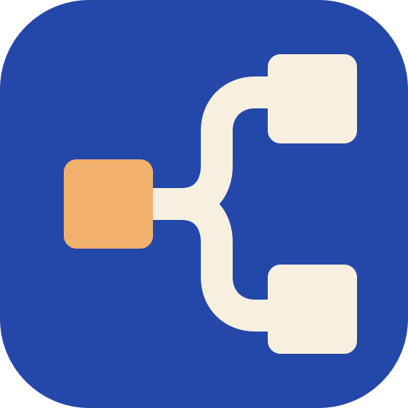

# T3 Workers

**Keep your main conversation. Delegate to your T3 workers.**

Use **Codex** or **Claude Code** to assign bounded jobs to persistent, visible
[T3 Code](https://github.com/pingdotgg/t3code) workers, follow their work and
bring back the results. Return to the same worker for a follow-up or recover an
interrupted assignment without starting over.

Your main agent—the **chief** in this guide—keeps the conversation and assesses
the result. T3 runs the workers and retains their conversations. This plugin
provides one shared skill, connection guidance and an optional quota reader; it
does not run another server or automatically route work between accounts. A
Claude Code chief that itself runs inside a T3 thread uses the separate
[T3 Workflow Relay](#mix-t3-workers-into-a-claude-code-workflow) plugin instead.
It is an independent Tiziano AI plugin, not a T3 product. Worker operations
use T3's official MCP directly; the skill adds instructions, not MCP tools.

**Alpha.** You need your own T3 environment, **T3 0.1.4 or later**, and a
native Codex or Claude Code client with plugin support. The operating method
uses T3's released outside-agent MCP, with current guidance, linked
environments included, source-reviewed at **0.1.7**; provider-mode mappings
remain checked at 0.1.6. The optional quota reader requires **protocol 2, an
RPC-only ticket route and compatible snapshot fields**, not a list of accepted
releases. Older servers without that ticket route are not supported by the
reader. Host, provider and recovery paths are not all live-qualified. See
[architecture and qualification](docs/architecture.md#qualification).

## Install

Install from [`Tiziano-AI/plugins`](https://github.com/Tiziano-AI/plugins),
the publisher marketplace named `tiziano-ai` in both hosts. Choose the commands
for your client. Installation does **not** install T3, authenticate provider
accounts or approve an MCP connection.

### Codex

```sh
codex plugin marketplace add Tiziano-AI/plugins
codex plugin add t3-workers@tiziano-ai
```

Use the CLI belonging to your intended Codex installation. A desktop app's
bundled runtime and another `codex` on your PATH can have different capabilities.
Alternatively, add the marketplace, select **T3 Workers** in the desktop plugin
directory and install it there. Start a fresh local chat and verify that the
skill is available; a Git checkout or marketplace listing alone is not proof
that the chat loaded it.

### Claude Code

```sh
claude plugin marketplace add Tiziano-AI/plugins
claude plugin install t3-workers@tiziano-ai --scope user
```

Run `/reload-plugins` where supported, or start a new session.

## Connect your T3 environment

If the chief already has callable T3 tools, **reuse that connection**. The
plugin deliberately does not bundle a second MCP registration, a fixed server
address or credentials. One connection is enough for several machines: the
chief reaches the environments you have linked in T3 by passing their
`environmentId`.

Otherwise, obtain the outside-agent MCP URL from your T3 environment. The
loopback example below applies only when the chief and T3 server run on the
same machine. Replace it with your exact endpoint and run **one** block.

**Codex**

```sh
T3_MCP_URL='http://127.0.0.1:3773/mcp'
codex mcp add t3 --url "$T3_MCP_URL"
codex mcp login t3
```

**Claude Code**

```sh
T3_MCP_URL='http://127.0.0.1:3773/mcp'
claude mcp add --transport http --scope user t3 "$T3_MCP_URL"
claude mcp login t3
```

Complete OAuth in the native consent flow. **In T3 0.1.0, Full access grants
environment-wide orchestration, settings-write and source-control-write
scopes**, not access limited to a named project. Choose the grant deliberately;
the plugin does not choose or approve it for you. Prefer the supported OAuth
route, not copied worker tokens or `Authorization` headers.

The installed [setup guide](skills/t3-workers/references/setup.md) covers
installation ownership, device pairing versus OAuth, headless service use,
the narrower native CLI scripting route, host-specific discovery and connection
recovery. No connection is propagated to workers automatically.

## First use

In the chat that will coordinate the work, start with an inspection:

> Use T3 Workers to inspect my fleet. Explain account and model eligibility,
> what we know about capacity, and any gap before you dispatch anything.

Then ask for a bounded contribution:

> Ask a suitable T3 worker to review this proposal without changing files.
> Keep my selected account and model, follow the work, send a follow-up if
> needed, and bring back your assessment of the actual result.

For an existing assignment:

> Recover the T3 worker for this assignment. Find its current state and result
> before deciding whether anything needs to be sent again.

You can describe the job normally or invoke `$t3-workers` in Codex and
`/t3-workers:t3-workers` in Claude Code. Use native subagents when they are
the simpler fit; use T3 when persistent visibility, another provider/account
or its execution environment adds value. Explicit account, model and option
selections are preserved.

### Limits worth knowing

- **Quota reads are optional and separate from outside-agent MCP in T3 0.1.7.** The
  bundled [quota reader](skills/t3-workers/references/limits.md) uses T3's native client
  RPC with a separately authorized read-only session. It requires Node.js
  22.15+, **protocol 2 and the RPC-only ticket route**; consumed fields are
  validated before returning data or refreshing. It
  reports native account/window snapshots, not an automatic quota router;
  old values can survive a failed refresh. T3's authenticated **Usage → Limits** remains the
  fallback when no reader credential is available. Installing the plugin does
  not authorize session issuance; an authorized temporary session can cover a
  batch of reads and must be closed out through T3's native lifecycle.
- **The chief must be active or return.** Waiting and later recovery are
  supported operating patterns. Internal T3 parent notifications do not prove
  that an idle external chief will wake up.
- **Results are not automatic memory ingestion.** Reading a worker's answer
  does not import its complete transcript into the chief's learned memory.
- **Worktrees isolate checkouts, not security, and they retire.** When your
  environment's storage cleanup removes inactive worktrees, ignored files go
  with them (unless it keeps "any local files"); the branch and conversation
  stay, and the next message recreates the checkout from the branch. Workers
  keep unique ignored outputs at their owner before their thread goes quiet.
- **Sign-ins and links expire after 30 days.** Neither the chief's MCP sign-in
  nor a link between environments renews itself; a person approves again.
  Approving again before expiry leaves the current grant working on T3, so
  renew early; see
  [Renew before a grant lapses](skills/t3-workers/references/setup.md#renew-before-a-grant-lapses).
- **Pass the model explicitly.** A launch without `modelSelection` takes the
  project default and, since T3 0.1.4, can move to a configured fallback
  account when the default's usage is exhausted.
- **Permission modes are ceilings, not new authority.** Publishing, spending,
  disclosure and unrelated work still need the user's commission. Human
  security approvals stay human.

The installed [capability guide](skills/t3-workers/references/capabilities.md)
explains the boundaries and links to released primary sources. The plugin does
not patch T3, change providers or install a supervisor, memory service or
polling daemon.

## Mix T3 workers into a Claude Code workflow

A Claude Code chief inside a T3 thread writes its own Workflow scripts. The
separate, Claude-only T3 Workflow Relay plugin lets any agent in such a script
run as a T3 worker on another account or provider, beside native agents: some
of them, all of them or none. The script stays the chief's own. An agent on the
chief's own account remains a plain `agent()`.

Install it in the Claude Code configuration home that T3 runs your chief in,
by running the commands with that home as `CLAUDE_CONFIG_DIR`. It is not part
of `t3-workers`, which serves a chief outside T3:

```sh
CLAUDE_CONFIG_DIR=<T3-claude-home> claude plugin marketplace add Tiziano-AI/plugins
CLAUDE_CONFIG_DIR=<T3-claude-home> claude plugin install t3-workflow-relay@tiziano-ai --scope user
```

In a script, the chief declares each worker's target and calls `t3Agent()`
where it would call `agent()`:

```js
const codex = { providerInstanceId: '<provider-instance-id>', model: '<model>',
                options: { '<option-id>': '<value>' } }
const built = await t3Agent({ key: 'build', title: 'Build the parser',
  role: 'implementation', target: codex, out: '/absolute/path/out/build.md',
  task: 'Read /absolute/path/in/build.md and do what it says.' })
const verdict = await agent(`Read ${built.out} and try to refute it.`)
```

Each relay is one cheap Claude agent that makes one `delegate_task` call and
returns its worker's two status lines. The worker has its own T3 thread and
its result stays in its file. The plugin's one skill, `t3-workflow-relay`,
carries the function to paste into the script and the rules that come with it.

**The chief must itself be a Claude Code session running inside a T3 thread, on
the machine where the output files live,** and it keeps its turn open until the
last relay has dispatched, because T3 refuses `delegate_task` once that turn has
ended. For one or two workers, or a worker you will talk to, follow up with or
inspect as you go, call `delegate_task` directly.

## Update

For Codex:

```sh
codex plugin marketplace upgrade tiziano-ai
codex plugin add t3-workers@tiziano-ai
```

For Claude Code:

```sh
claude plugin marketplace update tiziano-ai
claude plugin update t3-workers@tiziano-ai --scope user
claude plugin update t3-workflow-relay@tiziano-ai --scope user
```

Run these in each configuration home a plugin is installed in, the
marketplace update included: the relay usually lives in a T3 home, `t3-workers`
in the home of a chief outside T3.

Reload the supported host or start a new session and check the selected version.
Check the same configuration home you installed into. A Claude session using
an inline `--plugin-dir` or `--plugin-url` copy can shadow the marketplace
plugin and does not receive that plugin's marketplace update.

## Remove

For Codex:

```sh
codex plugin remove t3-workers@tiziano-ai
```

For Claude Code:

```sh
claude plugin uninstall t3-workers@tiziano-ai --scope user
claude plugin uninstall t3-workflow-relay@tiziano-ai --scope user
```

Disabling or uninstalling this plugin leaves the separately configured MCP
connection, OAuth grant, T3 service and accepted workers intact.
Stopping work, removing a connection and revoking its grant are separate
actions. Removing an entire marketplace can affect its installed plugins; it
is not an update-repair step.

## Development

```sh
python3 -m unittest discover -s tests -v
node --test tests/limits.test.mjs tests/t3-workflow-relay.test.mjs
claude plugin validate --strict .
claude plugin validate --strict .claude-plugin/plugin.json
claude plugin validate --strict plugins/t3-workflow-relay
```

These check this repository's manifests, delivered resources, synthetic
quota-protocol cases and the relay function as the skill prints it, with stubbed
agents, not the external catalog's fetch/install path or live worker success.
None installs the plugin or launches a worker. For local Claude
development without installation, use
`claude --plugin-dir /absolute/path/to/t3-workers`, or
`claude --plugin-dir /absolute/path/to/t3-workers/plugins/t3-workflow-relay`
for the relay; each starts an interactive host and is separate from
validation.

The [architecture](docs/architecture.md) records the packaging decisions,
primary documentation and remaining live qualification. Contributions should
preserve the single shared skill, native connection ownership and portable
examples. MIT licensed; not an official T3, OpenAI or Anthropic product.
