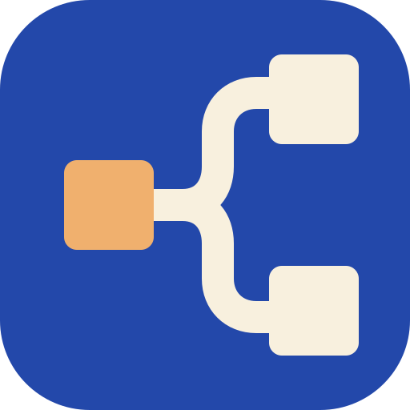

# T3 Workers

**Keep your main conversation. Delegate to your T3 workers.**

Use **Codex** or **Claude Code** to assign bounded jobs to persistent, visible
[T3 Code](https://github.com/pingdotgg/t3code) workers, follow their work and
bring back the results. Return to the same worker for a follow-up or recover an
interrupted assignment without starting over.

Your main agent—the **chief** in this guide—keeps the conversation and assesses
the result. T3 runs the workers and retains their conversations. This plugin
provides one shared skill, connection guidance and an optional quota reader;
it does not run another server or automatically route work between accounts.

**Alpha.** You need your own T3 environment and a native Codex or Claude Code
client with plugin support. The operating method uses the released **T3 0.1.0**
outside-agent contract; the optional quota reader accepts exactly **0.1.0 and
0.1.1 / protocol 2**. Host, provider and recovery paths are not all
live-qualified. See
[architecture and qualification](docs/architecture.md#qualification).

## Install

Install from [`Tiziano-AI/plugins`](https://github.com/Tiziano-AI/plugins),
the publisher marketplace named `tiziano-ai` in both hosts. Choose the commands
for your client. Installation does **not** install T3, authenticate provider
accounts or approve an MCP connection.

### Codex

```sh
codex plugin marketplace add Tiziano-AI/plugins
codex plugin add t3-workers@tiziano-ai
```

Use the CLI belonging to your intended Codex installation. A desktop app's
bundled runtime and another `codex` on your PATH can have different capabilities.
Alternatively, add the marketplace, select **T3 Workers** in the desktop plugin
directory and install it there. Start a fresh local chat and verify that the
skill is available; a Git checkout or marketplace listing alone is not proof
that the chat loaded it.

### Claude Code

```sh
claude plugin marketplace add Tiziano-AI/plugins
claude plugin install t3-workers@tiziano-ai --scope user
```

Run `/reload-plugins` where supported, or start a new session.

## Connect your T3 environment

If the chief already has callable T3 tools, **reuse that connection**. The
plugin deliberately does not bundle a second MCP registration, a fixed server
address or credentials.

Otherwise, obtain the outside-agent MCP URL from your T3 environment. The
loopback example below applies only when the chief and T3 server run on the
same machine. Replace it with your exact endpoint and run **one** block.

**Codex**

```sh
T3_MCP_URL='http://127.0.0.1:3773/mcp'
codex mcp add t3 --url "$T3_MCP_URL"
codex mcp login t3
```

**Claude Code**

```sh
T3_MCP_URL='http://127.0.0.1:3773/mcp'
claude mcp add --transport http --scope user t3 "$T3_MCP_URL"
claude mcp login t3
```

Complete OAuth in the native consent flow. **In T3 0.1.0, Full access grants
environment-wide orchestration, settings-write and source-control-write
scopes**, not access limited to a named project. Choose the grant deliberately;
the plugin does not choose or approve it for you. Prefer the supported OAuth
route, not copied worker tokens or `Authorization` headers.

The installed [setup guide](skills/t3-workers/references/setup.md) covers
installation ownership, device pairing versus OAuth, headless service use,
host-specific discovery and connection recovery. No connection is propagated
to workers automatically.

## First use

In the chat that will coordinate the work, start with an inspection:

> Use T3 Workers to inspect my fleet. Explain account and model eligibility,
> what we know about capacity, and any gap before you dispatch anything.

Then ask for a bounded contribution:

> Ask a suitable T3 worker to review this proposal without changing files.
> Keep my selected account and model, follow the work, send a follow-up if
> needed, and bring back your assessment of the actual result.

For an existing assignment:

> Recover the T3 worker for this assignment. Find its current state and result
> before deciding whether anything needs to be sent again.

You can describe the job normally or invoke `$t3-workers` in Codex and
`/t3-workers:t3-workers` in Claude Code. Use native subagents when they are
the simpler fit; use T3 when persistent visibility, another provider/account
or its execution environment adds value. Explicit account, model and option
selections are preserved.

### Limits worth knowing

- **Quota reads are optional and separate from MCP through T3 0.1.1.** The
  bundled [quota reader](skills/t3-workers/references/limits.md) uses T3's native client
  RPC with a separately authorized read-only session. It requires Node.js
  22.15+ and is qualified for exactly **T3 0.1.0 and 0.1.1 / protocol 2**. It
  reports native account/window snapshots, not an automatic quota router;
  old values can survive a failed refresh. T3's authenticated **Usage → Limits** remains the
  fallback when no reader credential is available. Installing the plugin does
  not authorize session issuance; an authorized temporary session can cover a
  batch of reads and must be closed out through T3's native lifecycle.
- **The chief must be active or return.** Waiting and later recovery are
  supported operating patterns. Internal T3 parent notifications do not prove
  that an idle external chief will wake up.
- **Results are not automatic memory ingestion.** Reading a worker's answer
  does not import its complete transcript into the chief's learned memory.
- **Worktrees isolate checkouts, not security.** Retain valuable outputs before
  relying on checkout cleanup; ignored files are not necessarily protected.
- **Permission modes are ceilings, not new authority.** Publishing, spending,
  disclosure and unrelated work still need the user's commission. Human
  security approvals stay human.

The installed [capability guide](skills/t3-workers/references/capabilities.md)
explains the boundaries and links to released primary sources. The plugin does
not patch T3, change providers or install a supervisor, memory service or
polling daemon.

## Update

For Codex:

```sh
codex plugin marketplace upgrade tiziano-ai
codex plugin add t3-workers@tiziano-ai
```

For Claude Code:

```sh
claude plugin marketplace update tiziano-ai
claude plugin update t3-workers@tiziano-ai --scope user
```

Reload the supported host or start a new session and check the selected version.

## Remove

For Codex:

```sh
codex plugin remove t3-workers@tiziano-ai
```

For Claude Code:

```sh
claude plugin uninstall t3-workers@tiziano-ai --scope user
```

Disabling or uninstalling this plugin leaves the separately configured MCP
connection, OAuth grant, T3 service and accepted workers intact.
Stopping work, removing a connection and revoking its grant are separate
actions. Removing an entire marketplace can affect its installed plugins; it
is not an update-repair step.

## Development

```sh
python3 -m unittest discover -s tests -v
node --test tests/limits.test.mjs
claude plugin validate --strict .
claude plugin validate --strict .claude-plugin/plugin.json
```

These check this repository's manifests, delivered resources and synthetic
quota-protocol cases, not the external catalog's fetch/install path or live
worker success. None installs the plugin or launches a worker. For local Claude
development without installation, use
`claude --plugin-dir /absolute/path/to/t3-workers`; that starts
an interactive host and is separate from validation.

The [architecture](docs/architecture.md) records the packaging decisions,
primary documentation and remaining live qualification. Contributions should
preserve the single shared skill, native connection ownership and portable
examples. MIT licensed; not an official T3, OpenAI or Anthropic product.
